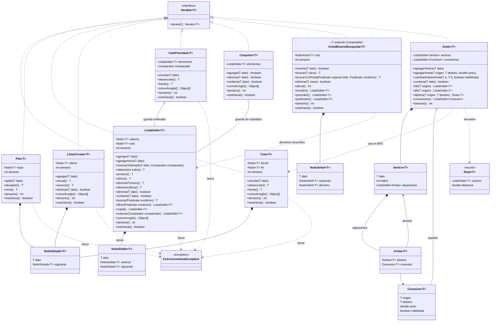
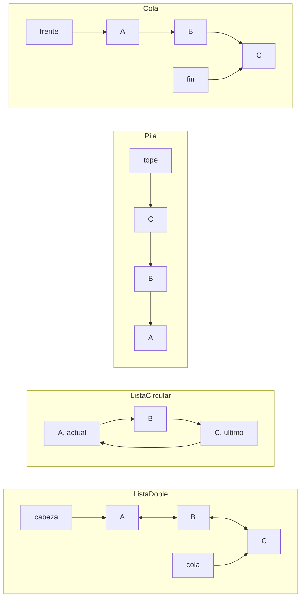
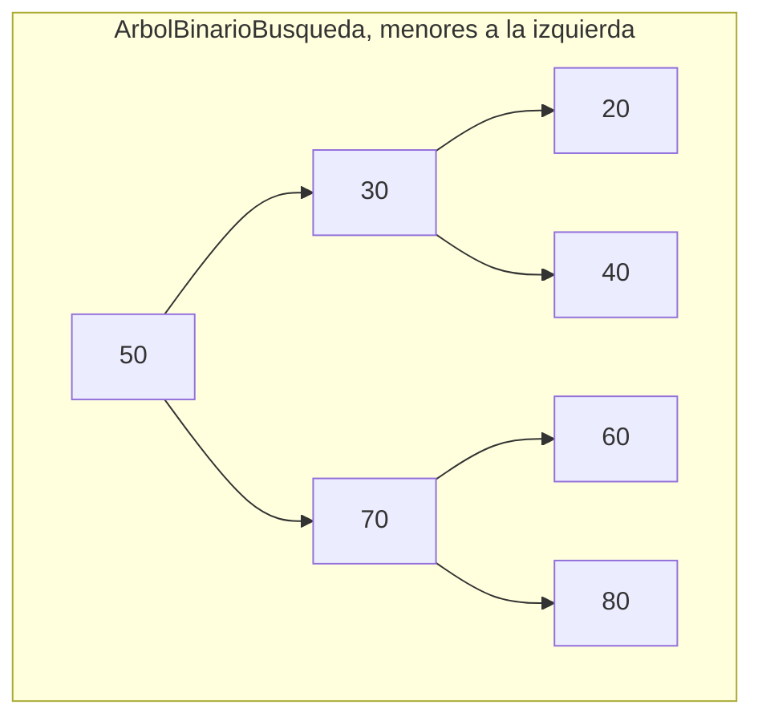

# Diagrama de estructuras propias

Todas las estructuras están en `co.edu.uniquindio.sga.estructuras`, son genéricas e implementan `Iterable<T>`. Ninguna usa colecciones de `java.util`. Las clases `Nodo`, `Vertice` y `Arista` son internas y privadas.

## Diagrama de clases de las estructuras

En el código, `NodoDoble`, `NodoSimple` y `NodoArbol` se llaman `Nodo` dentro de cada clase. Aquí tienen nombres distintos para que el diagrama se lea mejor.

## Cómo se enlazan los nodos

## Uso en el SGA

| Estructura | Dónde se usa | Tipo guardado |
|---|---|---|
| `ArbolBinarioBusqueda` | Catálogo de apartamentos por código | `Apartamento` |
| `ArbolBinarioBusqueda` | Huéspedes y empleados por documento | `Huesped`, `Empleado` |
| `ArbolBinarioBusqueda` | Reservas de cada apartamento por fecha de entrada, detección de solapamientos | `Reserva` |
| `Grafo` | Mapa del edificio, ruta de preparación, inalcanzables y bloques | `String` con el id del nodo |
| `ColaPrioridad` | Cola de preparación, entrada hoy primero y luego hora de llegada | `ItemPreparacion` |
| `ColaPrioridad` | Reservas Pendientes ordenadas por hora de vencimiento | `Reserva` |
| `Cola` | Solicitudes del canal externo en orden de llegada | `SolicitudExterna` |
| `Pila` | Deshacer la última operación del folio | `Movimiento` |
| `Pila` | Navegación atrás entre pantallas | `String` |
| `ListaDoble` | Ocupantes, desglose de noches, historial, todas las reservas | `Ocupante`, `NocheLiquidada`, `Reserva` |
| `ListaCircular` | Rotación de turnos de recepción | `Empleado` |
| `Conjunto` | Favoritos de cada huésped | `String` con el código del apartamento |

## Complejidad de las operaciones principales

| Estructura | Operación | Complejidad |
|---|---|---|
| `ListaDoble` | agregar al inicio o al final | O(1) |
| `ListaDoble` | buscar, eliminar, obtener | O(n) |
| `Pila` | apilar, desapilar | O(1) |
| `Cola` | encolar, desencolar | O(1) |
| `ColaPrioridad` | encolar | O(n), inserta en orden |
| `ColaPrioridad` | desencolar | O(1), el frente es el de mayor prioridad |
| `ListaCircular` | avanzar turno | O(1) |
| `Conjunto` | agregar, contiene | O(n) |
| `ArbolBinarioBusqueda` | insertar, buscar, eliminar | O(h), O(log n) si el árbol está balanceado |
| `Grafo` | BFS, DFS | O(V + E) |
| `Grafo` | Dijkstra | O(V²) |
